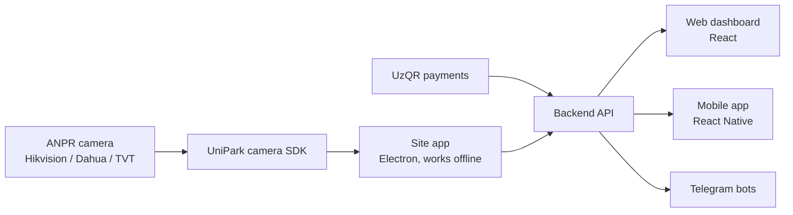

# UniPark

**Parking management that makes every soum visible.**

UniPark digitizes entry, exit and payment at bus stations, markets and paid parking lots, and gives owners and regulators a live dashboard. It is installed at 13 parking points in Bukhara, Kashkadarya and Surkhandarya, Uzbekistan.

Website: [unipark.uz](https://unipark.uz) · Built by Realsoft Academy LLC (Univora) · Tashkent, Uzbekistan


*UniPark dashboard (yearly view, Uzbek interface, 21 Nov 2026). Names and plates removed.*

## How it works

1. An ANPR camera at the gate reads the license plate.
2. UniPark's own SDK reads the result from the camera and logs the entry with photos.
3. The fee is applied by vehicle type and paid in cash or by UzQR.
4. Dashboards update for owners and control authorities on web, mobile and Telegram.

## Architecture



## Components

| Component | What it does | Technology | Code |
|---|---|---|---|
| Camera SDK | Reads plate results from the site's existing cameras | UniPark SDK | Private |
| Site app | Runs on the gate computer, logs every entry with photos, takes payments, keeps working offline | Electron | Private |
| Backend API | Stores events and payments and serves all clients | UniPark backend | Private |
| Web dashboard | Region, district and site views, history and reports for owners and control authorities | React | Private |
| Mobile app | Dashboard access and alerts on the phone | React Native | Private |
| Telegram bots | Online/offline alerts and daily reports | Telegram Bot API | Private |
| Landing page | This repository: the public website | Nuxt 4 | Public |

Core stack across the product: JavaScript, React, React Native, Electron.

The UniPark product source code is private because it contains customer and payment integrations. Architecture details, screenshots and a live demo are available on request.

## About this repository

This repository contains the public landing page of UniPark, built with Nuxt 4. The rest of the product (site app, backend, web dashboard, mobile app, Telegram bots) is developed in private repositories.

### Landing page tech stack

* **Framework:** Nuxt 4.2
* **UI:** Vue 3 + TailwindCSS
* **Icons:** Nuxt Icon with Lucide
* **Fonts:** Nuxt Fonts
* **Images:** Nuxt Image
* **Linting:** ESLint
* **Package manager:** pnpm

### Setup

Install dependencies:

```bash
pnpm install
```

Start the development server on `http://localhost:3000`:

```bash
pnpm dev
```

Build for production and preview locally:

```bash
pnpm build
pnpm preview
```

### Available scripts

| Command | Description |
|---------|-------------|
| `pnpm dev` | Start development server |
| `pnpm build` | Build for production |
| `pnpm preview` | Preview production build |
| `pnpm generate` | Generate static site |
| `pnpm exec eslint .` | Run linting |
| `pnpm exec eslint . --fix` | Fix linting issues |

### CI/CD

GitHub Actions handles continuous integration and deployment:

* **Deployment:** automatic deployment to production on push to `main`
* **Testing:** PR validation with linting and build checks
* **Security:** weekly dependency audits
* **Performance:** Lighthouse checks on PRs

Deploy by pushing to `main`, or trigger the workflow manually from the GitHub Actions tab. See [DEPLOYMENT.md](./DEPLOYMENT.md) for the server setup.

### Project structure

```
.
├── .github/
│   └── workflows/      # CI/CD workflows
├── app/
│   ├── components/     # Vue components
│   ├── pages/          # Nuxt pages
│   └── public/         # Static assets
├── assets/             # README images
├── DEPLOYMENT.md       # Deployment guide
└── nuxt.config.ts      # Nuxt configuration
```

### Documentation

* [Deployment guide](./DEPLOYMENT.md)
* [Workflows README](./.github/workflows/README.md)
* [Nuxt documentation](https://nuxt.com/docs)

## License

Copyright © Realsoft Academy LLC (Univora). All rights reserved.